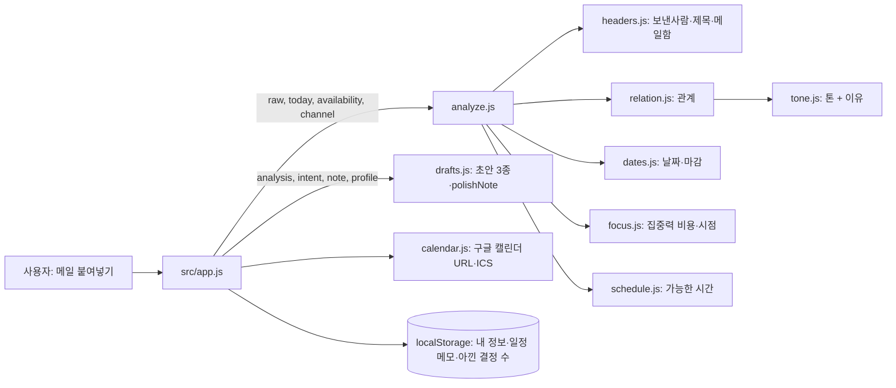
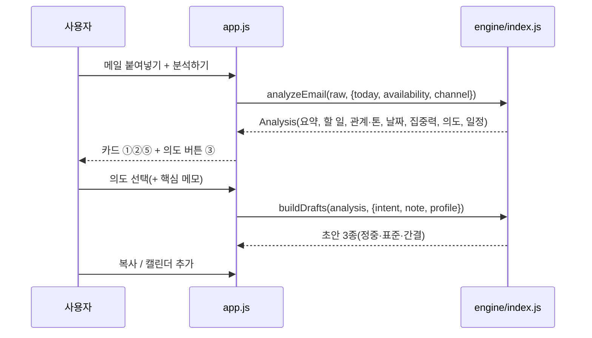

# Design Document

## Overview

정적 웹 앱 하나로 만든다. 화면(`src/app.js`)은 입력을 받아 엔진의 `analyzeEmail()`을 호출하고, 결과를 카드 ①~⑤로 그린다.
엔진(`src/engine/`)은 DOM도 네트워크도 모르는 순수 함수 모음이라 브라우저와 Node 테스트에서 똑같이 돈다.

처음 계획은 Gemini API로 요약·초안을 만드는 것이었지만, 세 가지 이유로 규칙 기반 엔진으로 바꿨다.
1. 공개 레포·정적 배포에는 API 키를 넣을 수 없다.
2. 심사위원이 키 없이 데모 주소만 열어도 동작해야 한다.
3. 메일 원문이 외부로 나가지 않는 것이 사용자에게 더 큰 가치다.

## Architecture





## Components and Interfaces

| 모듈 | 공개 함수 | 역할 | 요구사항 |
|---|---|---|---|
| analyze.js | `analyzeEmail(raw, { today, availability, channel })` | 전체 분석을 묶어 Analysis 반환 | 1, 2, 3, 5 |
| headers.js | 헤더·주소 파싱, 메일함 감지 | 보낸사람·받는사람·제목 줄 분리, 받는 주소 도메인으로 메일함 추정 | 1.3 |
| relation.js | 관계 판별 | 직함·호칭·말투 단서로 관계 결정 | 3.1, 3.3 |
| tone.js | 톤 추천 | tone-guide.md 표를 코드로 옮긴 규칙 | 3.2 |
| dates.js | 날짜 추출 | 절대·상대 날짜, 요일, 오전/오후 시간, 마감·약속 단서 | 5.1 |
| focus.js | 집중력 계산 | 점수·등급·처리 시점·이유 | 2 |
| schedule.js | `parseAvailability(memo)`, `suggestSlots({...})` | 바쁜 요일·오전/오후 해석, 후보 시간 3개 | 5.2, 5.3 |
| drafts.js | `buildDrafts(analysis, opts)`, `polishNote(note, level)` | 인사·본문·맺음말 조립, 메모 다듬기 | 4 |
| calendar.js | `googleCalendarUrl(evt)`, `buildIcs(evt)` | 캘린더 연동 | 5.4 |
| app.js | (화면) | 입력, 카드 렌더링, 복사, 저장 | 1.4, 4.5, 6.3 |

## Data Models

```ts
type Analysis = {
  channel: 'gmail'|'naver'|'naverworks'|'outlook'|'unknown'; channelLabel: string;
  from: { name: string|null; address: string|null; title: string|null };
  subject: string|null; body: string;
  relation: 'professor'|'boss'|'recruiter'|'client'|'senior'|'colleague'|'friend'|'unknown'; relationLabel: string;
  tone: { level: 'formal'|'polite'|'casual'; label: string; tips: string[]; reason: string };
  summary: string[]; asks: string[];
  dates: { text: string; date: string; time: string|null; kind: 'deadline'|'meeting'|'date' }[];
  deadline: { date: string|null; label: string };
  focus: { level: 'light'|'medium'|'heavy'; label: string; score: number; when: 'now'|'batch'|'deep'; whenLabel: string; reasons: string[] };
  intents: { id: 'accept'|'reschedule'|'decline'|'ask'|'ack'; label: string }[];
  schedule: { slots: { date: string; time: string; label: string }[]; tips: string[] };
};
type Draft = { style: 'polite'|'standard'|'brief'; label: '정중'|'표준'|'간결'; subject: string; body: string };
```

집중력 점수: 길이 + 요청 수 + 결정 단어 + 날짜 수 가중합. 30 미만 가벼움, 60 미만 보통, 그 이상 무거움.

## Error Handling

- 빈 입력: 분석하지 않고 안내 문구 표시.
- 헤더 줄이 없는 메일: 본문만으로 분석하고 보낸 사람은 '상대'로 표시.
- 날짜를 해석하지 못한 표현: 무시하고 마감은 "기한 없음 → 24시간 안에 답장 권장"으로 표시.
- 클립보드 API 실패: 숨긴 textarea + `execCommand('copy')`로 대체.
- localStorage 사용 불가(사생활 모드): 기본값으로 동작하고 저장만 건너뜀.

## Testing Strategy

- `node --test`로 엔진 단위 테스트(`tests/modules.test.js`)와 샘플 메일 4통 시나리오 테스트(`tests/samples.test.js`).
- 기준일 2026-11-14(토)로 고정해 날짜 계산을 결정론적으로 검증.
- 화면: headless Edge로 `?sample=N&intent=...` 상태를 스크린샷으로 확인(`docs/*.png`).
- 훅: 엔진·테스트 저장 시 `npm test` 자동 실행, 응답이 끝날 때 비밀정보 검사.
