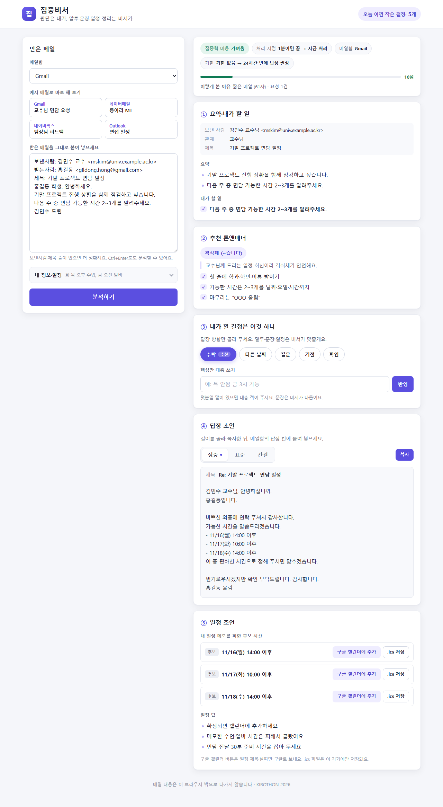

# 집중비서

지메일·네이버메일·네이버웍스·아웃룩을 함께 쓰는 대학생·사회초년생이 교수님·팀장님·채용 담당자에게 답장할 때마다 겪는 "언제 답하지, 어떤 말투로 쓰지, 그날 시간 되나" 같은 작은 결정을, 메일 붙여넣기 한 번으로 줄여 주는 집중력 비서입니다. **판단은 내가, 말투·문장·일정 정리는 비서가.**

**Demo:** https://dearyesang.github.io/Kirothon-team-021-2/ (설치·로그인·API 키 없이 바로 열림. 예시 화면: [교수님 면담 메일에 '수락' 선택](https://dearyesang.github.io/Kirothon-team-021-2/?sample=1&intent=accept), [메모 다듬기](https://dearyesang.github.io/Kirothon-team-021-2/?sample=1&intent=reschedule&note=%EB%AA%A9%20%EC%95%88%EB%90%A8%20%EA%B8%88%203%EC%8B%9C%20%EA%B0%80%EB%8A%A5), [팀장님 피드백 메일](https://dearyesang.github.io/Kirothon-team-021-2/?sample=3))



---

## 1. 문제 정의

### 대상 사용자
학교·인턴·대외활동 때문에 메일함을 두 개 이상(지메일·네이버메일·네이버웍스·아웃룩 등) 쓰는 대학생과 사회초년생입니다. 특히 교수님, 직장 상사, 채용 담당자처럼 말투를 신경 써야 하는 상대에게 메일을 자주 받는 사람이 주 사용자입니다. 이 프로젝트를 만든 저 역시 학교 메일·개인 메일·업무용 메일함을 오가며 같은 불편을 매일 겪습니다.

### 문제 상황
- **누가:** 수업·팀 프로젝트·인턴·대외활동을 함께 하는 대학생·사회초년생이
- **어떤 상황에서:** 과제나 업무에 집중하던 중 "다음 주 중 면담 가능한 시간을 알려 주세요"(교수님), "수요일 오후 3시까지 수정본 공유 부탁드립니다"(팀장님), "11월 16일까지 면접 일정 회신 부탁드립니다"(채용 담당자) 같은 메일을 받으면
- **무엇이 불편한지:** 답장 한 통에 작은 결정 6개를 혼자 내려야 합니다.
  1. 지금 할까, 나중에 할까
  2. 상대가 원하는 내용이 뭐지
  3. 어떤 말투가 맞지
  4. 첫 문장과 끝인사는 어떻게 쓰지
  5. 그 시간에 일정이 되나
  6. 정해진 일정은 어디 적어 두지

  몇 줄짜리 메일도 "이 말투가 실례는 아닐까" 하는 마음 부담 때문에 미루게 됩니다. 미룬 메일은 머릿속에 남아 하던 일의 집중을 계속 깨뜨립니다. 메일함이 여러 개라 이 고민을 앱마다 반복합니다. 시간이 문제가 아니라, 하루에 쓸 수 있는 한정된 **집중력**이 작은 결정들에 새어 나가는 것이 문제입니다.

### 기존 방식과 한계

| 지금 쓰는 방법 | 한계 |
|---|---|
| 검색으로 "교수님 메일 예절" 예문 찾기 | 면담·거절·일정 변경 등 상황마다 다시 찾아야 하고, 내 일정은 반영되지 않습니다. |
| 선배·친구에게 말투 검사 부탁 | 다른 사람의 시간을 쓰고, 답을 기다리는 동안 메일이 계속 머릿속에 남습니다. |
| 메일 앱의 AI 글쓰기 (Gmail 'Help me write', Outlook Copilot) | 그 메일 앱 안에서만 동작하고, 말투와 길이를 내가 골라야 합니다. 언제 처리할지, 그 시간에 일정이 되는지는 알려 주지 않습니다. |
| ChatGPT에 메일 복사·붙여넣기 | 매번 "교수님께 정중하게…" 같은 요청문을 써야 해서 결정이 오히려 하나 늘어납니다. 이름·학번·회사 정보가 담긴 원문이 외부 서버로 나갑니다. |

### 근거
- 평균 직장인은 **하루 117통**의 메일을 받고, 대부분을 1분도 안 되는 시간에 훑어봅니다. ([Microsoft Work Trend Index 특별 보고서, 2025](https://www.microsoft.com/en-us/worklab/work-trend-index/breaking-down-infinite-workday))
- Microsoft 365 사용자는 근무 시간 중 **평균 2분마다** 회의·메일·알림으로 하던 일이 끊깁니다. ([같은 보고서, 2025](https://www.microsoft.com/en-us/worklab/work-trend-index/breaking-down-infinite-workday))
- 응답자의 **68%**가 업무 중 방해받지 않고 집중할 시간이 부족하다고 답했습니다. ([Microsoft 2023 Work Trend Index, 31개국 31,000명](https://news.microsoft.com/annual-wti-2023))
- 일이 끊기면 원래 일로 돌아오기까지 **평균 23분 15초**가 걸리고, 그 사이 다른 일 2개 정도를 거칩니다. ([UC Irvine, Gloria Mark 교수 인용 기사, 2016](https://ics.uci.edu/2016/07/25/quartz-neuroscientists-say-multitasking-literally-drains-the-energy-reserves-of-your-brain-mark-quoted/))
- 지식 노동자는 한 주 업무 시간의 **28%**(40시간 기준 약 11시간)를 메일을 읽고 쓰는 데 씁니다. ([McKinsey Global Institute 보고서를 다룬 Washington Post 기사, 2012](https://www.washingtonpost.com/blogs/post-leadership/post/how-much-time-you-really-spend-emailing-at-work/2012/07/31/gJQAI50sMX_blog.html))
- 하루 메일 시간이 길수록 스스로 느끼는 생산성은 낮고 측정된 스트레스는 높았습니다. ([Mark 외, CHI 2016](https://doi.org/10.1145/2858036.2858262)) 끝내지 못한 일은 '주의 잔여물'로 남아 다음 일의 성과를 떨어뜨립니다. ([Leroy, 2009](https://www.researchgate.net/publication/46489122_Why_is_it_so_Hard_to_do_My_Work_The_Challenge_of_Attention_Residue_when_Switching_Between_Work_Tasks))

### 목표
- 메일 1통을 처리할 때 내가 직접 내리는 결정을 **6개에서 1개**(의도 선택: 수락·다른 날짜·거절·질문·확인)로 줄입니다.
- 메일마다 집중력 비용(가벼움·보통·무거움)과 처리 시점(지금·몰아서·집중 시간에)을 알려 줍니다. 가벼운 메일은 바로 끝내고, 무거운 메일이 집중 시간을 깨지 않게 합니다.
- 메일 속 날짜를 빈 시간 추천과 구글 캘린더 추가로 이어서 "어디 적어 두지"를 머릿속에서 지웁니다.
- 모든 처리를 브라우저 안에서만 해서 메일 원문이 밖으로 나가지 않게 합니다. API 키도 쓰지 않습니다.

---

## 2. 핵심 기능

| 기능 | 해결하는 불편 | 코드 위치 |
|---|---|---|
| ① 요약·내가 할 일: 보낸 사람·제목·요청·날짜·기한을 뽑고, 받는 주소로 메일함(Gmail·네이버메일·Outlook)을 알아봄. 네이버웍스처럼 회사 도메인은 메일함 선택으로 지정 | "무슨 내용이지?" 다시 읽기, 메일함마다 다른 화면 | `src/engine/analyze.js` (`analyzeEmail`, `summarize`, `extractAsks`), `src/engine/headers.js` (`parseHeaders`, `detectChannel`) |
| 집중력 비용(가벼움·보통·무거움, 0~100점)과 처리 시점(지금·몰아서·집중 시간에)을 이유와 함께 표시. 기한이 오늘·내일이면 '지금'으로 올림 | "지금 답할까, 나중에 할까" 결정과 하던 일 끊김 | `src/engine/focus.js` (`assessFocus`) |
| ② 관계 기반 톤앤매너 추천과 이유: 교수님·직장 상사·채용 담당자·고객은 격식체, 선배·동료는 해요체, 친구는 반말. 팁 2~3개(예: 첫 줄에 학과·학번·이름, 끝인사 '올림') | "이 말투가 실례는 아닐까" 걱정 | `src/engine/relation.js` (`detectRelation`), `src/engine/tone.js` (`recommendTone`), 기준 문서 `.kiro/steering/tone-guide.md` |
| ③ 의도 1클릭(수락·다른 날짜·거절·질문·확인)과 핵심 메모 → ④ 답장 초안 3종(정중·표준·간결). '목 안됨 금 3시 가능' 같은 메모를 "목요일은 어렵고, 금요일 3시는 가능합니다."로 다듬어 넣음 | 첫 문장·끝인사·문장 다듬기 고민 | `src/engine/drafts.js` (`buildDrafts`, `polishNote`) |
| ⑤ 일정 조언: '다음 주 중', '수요일 오후 3시까지' 같은 날짜 표현을 읽고, 내 일정 메모('화·목 오후 수업, 금 오전 알바')를 피해 서로 다른 날의 후보 3개 추천. 구글 캘린더 추가와 .ics 파일 | "그날 되나? 어디 적어 두지?" | `src/engine/dates.js` (`extractDates`), `src/engine/schedule.js` (`parseAvailability`, `suggestSlots`), `src/engine/calendar.js` (`googleCalendarUrl`, `buildIcs`) |
| 화면: 붙여넣기, 샘플 메일 4종, 초안 복사, 내 정보·일정 메모 저장, '오늘 아낀 작은 결정' 카운터. CSP `connect-src 'none'`으로 네트워크 전송을 막음 | 설치·로그인·API 키 없이 바로 써 보기, 개인정보 걱정 | `index.html`, `src/app.js`, `src/samples.js`, `src/styles.css` |

## 3. 사용 시나리오

샘플 S1(교수님 면담 요청)으로 설명합니다. [이 상태 그대로 열어 보기](https://dearyesang.github.io/Kirothon-team-021-2/?sample=1&intent=accept)

1. **메일 붙여 넣기:** 과제 중이던 홍길동 학생이 지메일로 김민수 교수님의 "기말 프로젝트 면담 일정" 메일을 받습니다. 본문을 복사해 집중비서에 붙여 넣습니다(데모에서는 샘플 'Gmail · 교수님 면담 요청' 선택). 받는 주소를 보고 메일함이 Gmail로 표시됩니다.
2. **① 요약과 처리 시점 확인:** 할 일 "다음 주 중 면담 가능한 시간 2~3개를 알려주세요"와 집중력 비용 '가벼움(16점) → 1분이면 끝 → 지금 처리'가 뜹니다. 길동은 미루지 않고 바로 끝내기로 합니다.
3. **② 말투 확인:** 상대가 교수님이라 격식체(~습니다)를 추천하고, 이유("교수님께 드리는 일정 회신이라 격식체가 안전해요")와 팁(첫 줄에 학과·학번·이름, 끝인사는 '올림')을 보여 줍니다.
4. **③ 의도 1클릭:** 맨 앞에 추천된 '수락'을 누릅니다. 일정 메모 '화·목 오후 수업, 금 오전 알바'를 반영해 다음 주 후보 3개(11/16(월) 14:00, 11/17(화) 10:00, 11/18(수) 14:00)가 서로 다른 요일로 제안됩니다.
5. **④ 초안 고르기:** 정중·표준·간결 초안 중 '정중'을 복사해 지메일 답장 창에 붙여 넣고 보냅니다. 덧붙일 말이 있으면 핵심 메모(예: '목 안됨 금 3시 가능')만 적으면 문장으로 다듬어져 초안에 들어갑니다.
6. **⑤ 일정 기록:** 교수님이 시간을 정해 주면 '구글 캘린더에 추가'로 면담을 넣고 "면담 전날 30분 준비 시간을 잡아 두세요" 팁을 확인합니다. 메일은 머릿속에서 빠지고, 길동은 하던 과제로 돌아갑니다.

## 4. 기대 효과

| 항목 | 지금 | 집중비서 사용 후 | 설명 |
|---|---|---|---|
| 메일 1통당 내가 내리는 결정 | 6개 | 1개 (의도 1클릭) | 내용(①), 말투(②), 문장(④), 일정 확인·기록(⑤), 처리 시점(집중력 비용)은 비서가 정리하고, 무엇을 답할지만 내가 고릅니다. |
| 답장 하나에 오가는 곳 | 4곳 (메일 앱·예문 검색·캘린더·메모) | 2곳 (집중비서 + 보내는 메일 앱) | 요약·말투·초안·일정이 한 화면에 있습니다. |
| 답장 초안이 나오기까지 내 조작 | 인사말·본문·맺음말을 직접 작성 | 붙여넣기 1번 + 클릭 1번 | 분석은 브라우저 안에서 1초 안에 끝납니다. |
| 일정 등록 때 직접 입력하는 칸 | 3칸 (제목·날짜·시간) | 0칸 (클릭 1번) | 구글 캘린더 링크에 값이 미리 채워집니다. |
| 메일 원문 외부 전송 | 클라우드 AI를 쓰면 매번 전송 | 0건 (네트워크 호출 0회, API 키 0개) | 분석은 모두 브라우저 안 규칙 엔진에서 합니다. |
| 메일 때문에 끊기는 집중 | 가벼운 메일도 미뤄 두면 머릿속에 남음 | '가벼움' 메일은 1분 안에 끝내고, '무거움' 메일은 집중 시간에 몰아서 처리 | 끊긴 일로 돌아오는 데 평균 23분 15초가 걸립니다(Gloria Mark). |

**로드맵:** 메일 → 메신저(슬랙·카카오톡) → AI 통화(에이닷) → AI 회의록(클로바노트·TIRO). 관계로 말투를 정하고, 날짜로 일정을 잡고, 집중력 비용으로 처리 시점을 정하는 같은 엔진을 채널만 넓혀 씁니다.

## 5. 차별점

| 비교 항목 | Gmail 'Help me write' (Gemini) | Outlook Copilot | ChatGPT에 복붙 | **집중비서** |
|---|---|---|---|---|
| 여러 메일함 통합 | Gmail 안에서 사용 | Outlook 안에서 사용 | 메일함과 상관없지만 매번 복사하고 요청문을 씀 | 어느 메일함 메일이든 붙여넣기 한 번. 받는 주소로 메일함을 알아봄 |
| 관계 기반 존댓말 | 격식·길이 등을 내가 지시 | 말투·길이를 내가 선택 | 요청문으로 내가 설명 | 보낸 사람이 교수님·직장 상사·채용 담당자·선배·친구 중 누구인지 읽고 말투 단계와 이유를 먼저 제안 |
| 집중력 기준 처리 시점 | 초안 작성이 중심 | 초안 작성이 중심 | 따로 물어봐야 함 | 집중력 비용(가벼움·보통·무거움)으로 지금·몰아서·집중 시간에 중 하나를 제안 |
| 메일 원문이 나가는지 | 클라우드 AI에서 처리 | 클라우드 AI에서 처리 | 외부 서버로 전송 | 브라우저 밖으로 안 나감 (네트워크 호출 없음, API 키 없음) |
| 일정까지 연결 | 초안과 별도로 처리 | 초안과 별도로 처리 | 따로 요청해야 함 | 일정 메모를 반영한 후보 3개, 구글 캘린더 추가와 .ics 파일까지 한 화면에서 |

- **결과가 매번 같습니다.** 규칙 엔진이라 같은 메일에는 같은 결과가 나오고, 왜 그 말투를 골랐는지 이유를 문장으로 보여 줍니다.
- **판단은 사용자에게 남깁니다.** 수락할지 거절할지는 내가 고르고, 나머지 정리만 비서가 합니다. 메일을 대신 보내지도 않습니다.

---

## 6. 설치와 실행

Node.js 18 이상만 있으면 됩니다. 설치할 npm 패키지가 없어서 `npm install`이 필요 없습니다.

```bash
# 1. 의존성 설치
#    설치할 npm 의존성이 없습니다. 레포를 받고 Node.js 버전만 확인하세요.
git clone https://github.com/DearYesang/Kirothon-team-021-2.git
cd Kirothon-team-021-2
node -v          # v18 이상이면 됩니다

# 2. 실행
npm start        # http://127.0.0.1:5173 을 브라우저로 엽니다 (내 컴퓨터에서만 접속됨)
```

설치 없이 보려면 [Demo](https://dearyesang.github.io/Kirothon-team-021-2/)를 여세요. 샘플 메일 4종(교수님 면담, 동아리 MT, 팀장님 피드백, 면접 일정)으로 바로 시험할 수 있습니다. 주소 뒤에 `?sample=1~4`, `&intent=accept|reschedule|decline|ask|ack`, `&note=메모`를 붙이면 그 상태로 바로 열립니다.

## 7. 테스트

```bash
npm test               # Node 내장 테스트 러너(node:test), 추가 설치 없음
npm run check:secrets  # 레포에 API 키·토큰·.env가 없는지 검사
```

- `tests/modules.test.js` (10개): 문장 분리, 헤더·메일함 감지, 관계 판별, 톤 추천, 한국어 날짜·시간 추출, 집중력 계산, 일정 메모·후보 시간, 메모 다듬기, 초안, 캘린더 URL·ICS.
- `tests/samples.test.js` (6개): 샘플 메일 4종(S1~S4)의 관계·말투, 날짜·기한, 집중력 비용·처리 시점, 초안 3종, 일정 후보, 캘린더 출력.
- 기준 날짜를 2026-11-14(토)로 고정해 언제 돌려도 결과가 같습니다. 현재 16개 모두 통과합니다.
- 화면은 headless Edge로 캡처해 확인했습니다: `docs/screenshot.png`(S1 수락), `docs/screenshot-3.png`(S3 팀장님), `docs/screenshot-note.png`(메모 다듬기), `docs/screenshot-mobile.png`(좁은 화면).

---

## 팀

- **팀 번호:** team-021
- **팀명:** 오픈랩

| 이름 | 역할 |
|---|---|
| DearYesang | 1인 팀: 기획, 문제 정의, 디자인, 개발, 발표 |
